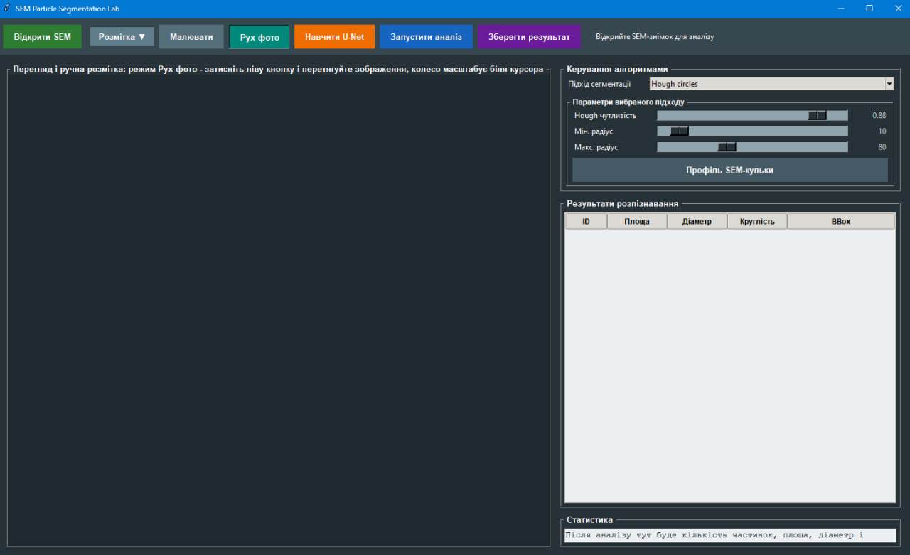
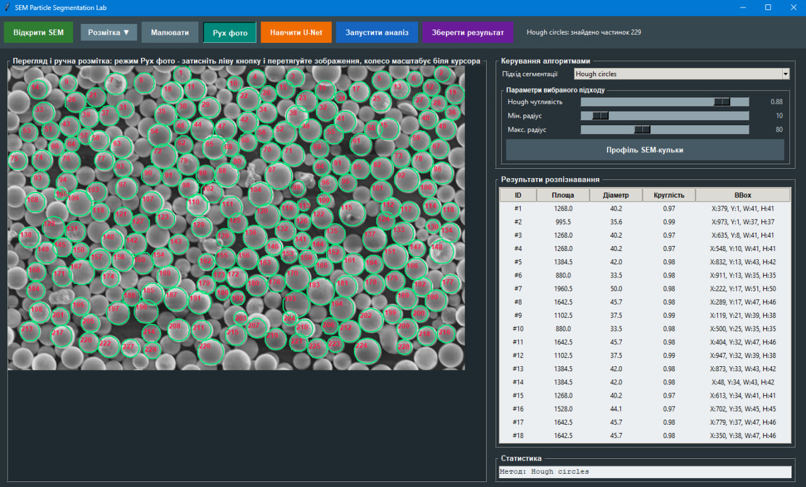
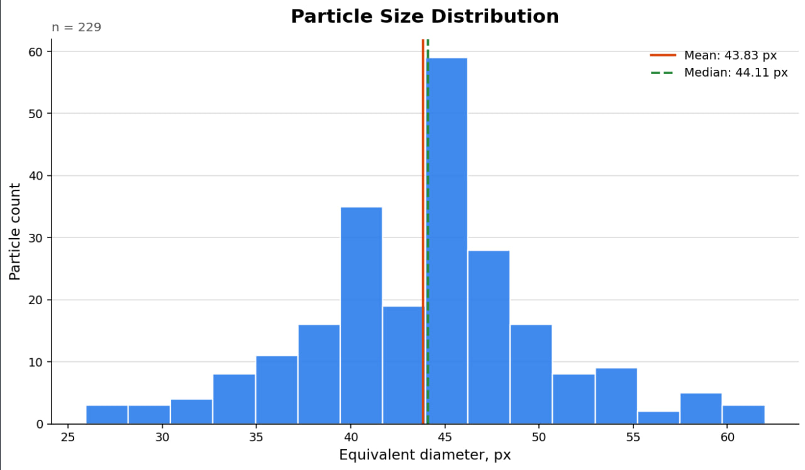

# 🔬 SEM Particle Segmentation Lab

A Python desktop application for automated particle segmentation, measurement, and quantitative analysis of Scanning Electron Microscopy (SEM) images.

The application combines traditional computer vision algorithms with a deep learning-based U-Net architecture, allowing users to compare segmentation approaches, analyze particle characteristics, and export results for further processing.

**Author:** Ostap Bednarchuk

## ✨ Key Features

- **SEM Image Processing:** Import and analyze images in PNG, JPG, JPEG, BMP, and TIFF formats.
- **Multiple Segmentation Methods:** Otsu thresholding, adaptive thresholding, Hough Circle Transform, and U-Net.
- **Interactive Annotation:** Manually annotate particles using polygon-based tools.
- **Deep Learning:** Train a U-Net segmentation model using manually annotated images.
- **Data Augmentation:** Generate additional training samples through image transformations.
- **Particle Measurements:** Calculate area, equivalent diameter, circularity, and bounding boxes.
- **Data Visualization:** Generate particle size distribution histograms and statistical summaries.
- **Result Export:** Save segmentation masks, annotated images, CSV measurements, and plots.
- **Desktop Interface:** Interact with the application through a Tkinter-based GUI.

---

## 📸 Application Screenshots

### Application Interface



### Particle Segmentation Results



### Particle Size Distribution



---


## 🛠️ Tech Stack

| Category | Technologies |
|---|---|
| Programming Language | Python 3.10+ |
| Computer Vision | OpenCV |
| Deep Learning | PyTorch, U-Net |
| Data Processing | NumPy |
| Image Processing | Pillow |
| Data Visualization | Matplotlib |
| Desktop GUI | Tkinter |
| Data Export | CSV, JSON, PNG |

---

## 🧠 Segmentation Methods

The application implements four segmentation approaches.

### 1. Otsu Thresholding + Morphology

A traditional segmentation method that automatically determines a threshold based on the image's intensity distribution.

Morphological operations help remove noise and improve the separation of detected particles.

**Best suited for:** SEM images with relatively uniform backgrounds and clearly distinguishable particles.

### 2. Adaptive Thresholding

Applies local thresholding to different regions of an image.

Unlike global thresholding, this approach can handle variations in brightness and contrast.

**Best suited for:** Images with uneven illumination or locally varying backgrounds.

### 3. Hough Circle Transform

Detects circular and approximately circular structures using the Hough Transform.

Users can configure parameters such as detection sensitivity and minimum/maximum particle radius.

**Best suited for:** Images containing predominantly circular particles.

### 4. U-Net Neural Network

A convolutional neural network designed for image segmentation.

The application supports:

- Creating binary masks from manual annotations.
- Preparing training data.
- Applying data augmentation.
- Training a U-Net model.
- Generating segmentation masks.
- Adjusting prediction thresholds.

**Best suited for:** Images requiring a learned segmentation approach, particularly when traditional thresholding methods are insufficient.

U-Net performance depends on the amount and quality of training annotations and the similarity between training and test images.

---

## 📐 Particle Analysis

After segmentation, the application calculates geometric characteristics of detected particles.

| Metric | Description |
|---|---|
| `area_px` | Particle area in pixels |
| `equivalent_diameter_px` | Diameter of a circle with an equivalent area |
| `circularity` | Measure of how closely the particle resembles a circle |
| `bbox` | Bounding rectangle around the particle |
| `particle_count` | Total number of detected particles |
| `mask_coverage` | Percentage of image area classified as particles |
| `mean_area` | Average particle area |
| `median_area` | Median particle area |
| `mean_equivalent_diameter` | Average equivalent particle diameter |

The equivalent diameter is calculated as:

$$
d_{eq} = \sqrt{\frac{4A}{\pi}}
$$

Where:

- `A` is the particle area.
- `d_eq` is the equivalent diameter.

Measurements are expressed in pixels unless an external calibration is applied.

---

## 🏗️ Project Structure

```text
sem-particle-segmentation-lab/
│
├── main.py
├── app.py
├── segmentation.py
├── training_utils.py
├── unet_model.py
├── particle_metrics.py
├── file_operations.py
├── ui_helpers.py
├── requirements.txt
└── README.md
```

### Module Responsibilities

| File | Purpose |
|---|---|
| `main.py` | Application entry point |
| `app.py` | Graphical interface and application workflow |
| `segmentation.py` | Traditional segmentation algorithms |
| `training_utils.py` | Training data preparation, augmentation, and U-Net training |
| `unet_model.py` | U-Net neural network architecture |
| `particle_metrics.py` | Particle measurements and statistical analysis |
| `file_operations.py` | Import/export of annotations, masks, images, and CSV files |
| `ui_helpers.py` | Reusable graphical interface utilities |

---

## 🚀 Installation

### Prerequisites

- Python 3.10 or newer
- Git
- Windows, Linux, or macOS
- Required Python dependencies

### 1. Clone the Repository

```bash
git clone https://github.com/Ostap8943/sem-particle-segmentation-lab.git
cd sem-particle-segmentation-lab
```

### 2. Create a Virtual Environment

**Windows:**

```bash
python -m venv .venv
.venv\Scripts\activate
```

**Linux / macOS:**

```bash
python3 -m venv .venv
source .venv/bin/activate
```

### 3. Install Dependencies

```bash
pip install -r requirements.txt
```

If the requirements file is unavailable, the main dependencies can be installed manually:

```bash
pip install opencv-python numpy pillow matplotlib torch torchvision
```

### 4. Run the Application

```bash
python main.py
```

The application will launch the SEM Particle Segmentation Lab graphical interface.

**Note:** Sample SEM images are not included in the repository. Users must provide their own images for analysis.

---

## 🖥️ Usage Guide

### Step 1 — Load an SEM Image

Launch the application and select an SEM image from your computer.

Supported formats include:

- PNG
- JPG / JPEG
- BMP
- TIFF

### Step 2 — Select a Segmentation Method

Choose one of the available approaches:

- Otsu + Morphology
- Adaptive Thresholding
- Hough Circles
- U-Net

### Step 3 — Configure Parameters

Adjust the available parameters according to the selected method.

These may include:

- Minimum particle area
- Threshold settings
- Morphological filtering
- Circle detection parameters
- U-Net prediction threshold

### Step 4 — Train U-Net (Optional)

To use the neural network approach:

1. Enable manual annotation mode.
2. Draw polygons around particles.
3. Save the annotations.
4. Configure training parameters.
5. Enable data augmentation if needed.
6. Start U-Net training.

The application converts manual annotations into binary segmentation masks for training.

### Step 5 — Run the Analysis

Start the segmentation process.

The application identifies particle regions and calculates the corresponding measurements.

### Step 6 — Export Results

Export the generated masks, annotated images, measurement tables, and statistical visualizations.

---

## 📊 Particle Size Distribution

The application supports quantitative analysis of particle sizes.

A particle size distribution histogram is generated using the `equivalent_diameter_px` values.

The visualization includes:

- **X-axis:** Equivalent particle diameter in pixels.
- **Y-axis:** Number of particles within each diameter interval.
- **Mean:** Average equivalent diameter.
- **Median:** Median equivalent diameter.

These visualizations help compare segmentation results and examine the distribution of detected particle sizes.

---

## 💾 Output Files

The application can export the following results:

| Output | Description |
|---|---|
| `*_annotated.png` | SEM image with detected contours and particle labels |
| `*_mask.png` | Binary segmentation mask |
| `*_measurements.csv` | Particle measurements and geometric properties |
| `*_diameter_distribution.png` | Particle size distribution histogram |
| JSON annotations | Saved manual annotations for reuse |

Manual annotations can be loaded again to continue work or train the U-Net model without recreating the annotations.

---

## 🔍 Technical Highlights

### Image Processing Pipeline

The traditional computer vision workflow includes:

1. Image loading and preprocessing.
2. Thresholding or geometric detection.
3. Noise reduction and morphological operations.
4. Particle contour extraction.
5. Geometric measurement.
6. Statistical analysis.
7. Result visualization and export.

### U-Net Training Workflow

The neural network workflow includes:

1. Manual particle annotation.
2. Binary mask generation.
3. Training sample preparation.
4. Data augmentation.
5. U-Net model training.
6. Segmentation prediction.
7. Threshold-based mask generation.
8. Particle analysis and export.

### Data Augmentation

The training pipeline supports transformations such as rotations and flips to increase the variety of training examples.

This is particularly useful when the manually annotated dataset is limited.

---

## ⚠️ Limitations

Segmentation performance depends on several factors:

- SEM image quality and resolution.
- Image contrast and background noise.
- Particle shape and density.
- Overlapping or touching particles.
- Selected segmentation parameters.
- Quantity and quality of training annotations.
- Similarity between training and evaluation images.

Traditional methods may struggle with complex backgrounds, while U-Net requires suitable annotated training data.

The application is intended for image analysis and experimentation. Segmentation results should be visually inspected before drawing scientific conclusions.

---

## 🐛 Troubleshooting

| Problem | Possible Cause | Suggested Solution |
|---|---|---|
| Too few particles detected | Threshold or minimum area is too high | Reduce the threshold or minimum area |
| Too much noise detected | Insufficient filtering | Increase minimum area or morphological filtering |
| Adaptive threshold produces fragments | Unsuitable local threshold settings | Adjust block size and constant |
| Hough Circles misses particles | Incorrect radius range | Adjust minimum and maximum radius |
| U-Net misses particles | Limited annotations or unsuitable threshold | Add annotations and adjust prediction settings |
| Fragmented U-Net predictions | Insufficient training examples | Improve annotations and data augmentation |
| Export fails | Invalid path or insufficient permissions | Choose another output directory |

---

## 📚 References

### Documentation

- [OpenCV Documentation](https://docs.opencv.org/)
- [PyTorch Documentation](https://pytorch.org/docs/)
- [NumPy Documentation](https://numpy.org/doc/)
- [Matplotlib Documentation](https://matplotlib.org/stable/)
- [Pillow Documentation](https://pillow.readthedocs.io/)

### Research Papers

1. Otsu, N. (1979). A Threshold Selection Method from Gray-Level Histograms. *IEEE Transactions on Systems, Man, and Cybernetics.*

2. Ronneberger, O., Fischer, P., & Brox, T. (2015). U-Net: Convolutional Networks for Biomedical Image Segmentation. *MICCAI.*

3. Duda, R. O., & Hart, P. E. (1972). Use of the Hough Transformation to Detect Lines and Curves in Pictures. *Communications of the ACM.*


